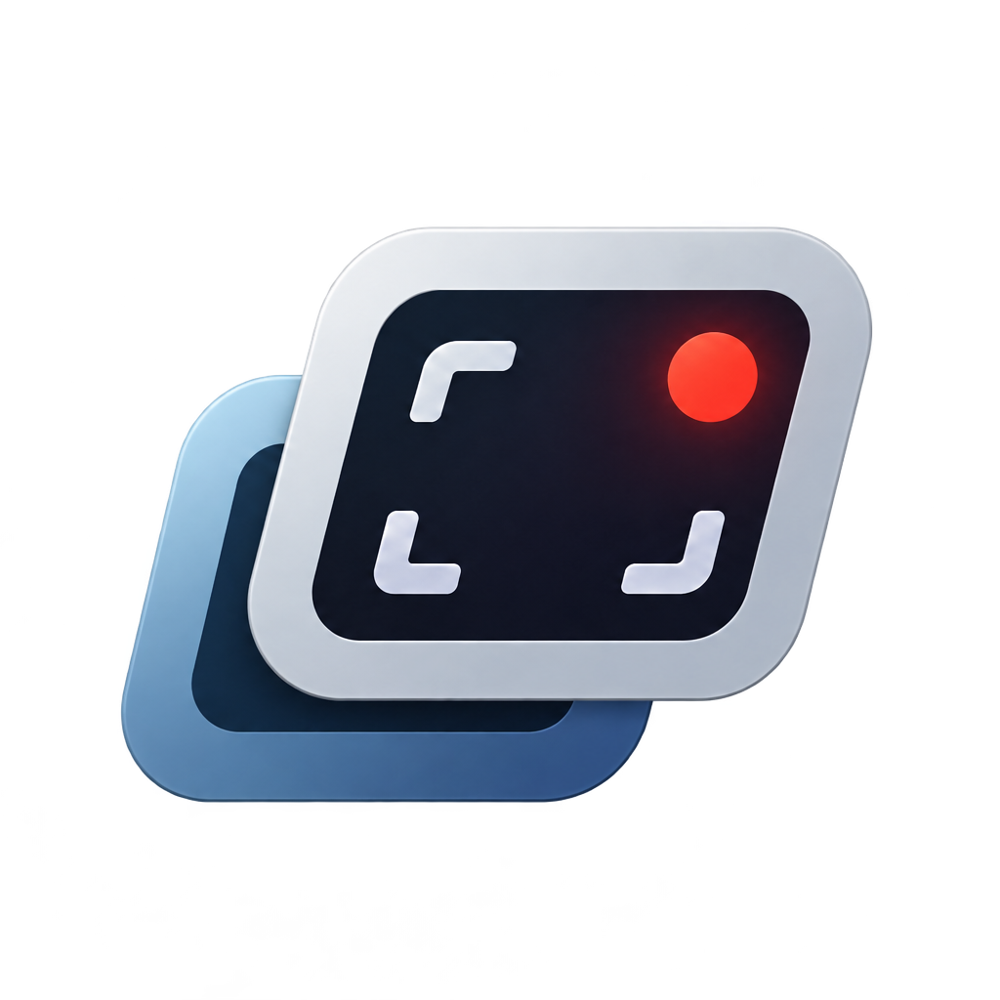

# Clipago



Windows-приложение для сохранения последних 30–120 секунд экрана, быстрой обрезки и экспорта видео.

Интерфейс: **Tauri 2, React, Radix UI, Lucide, Inter**. Захват, сжатый буфер, горячие клавиши и экспорт выполняются в Rust. Electron не используется.

## Запуск

Скачайте `Clipago_*_x64-setup.exe` из [GitHub Releases](https://github.com/greeeenie/clipago/releases/latest) и запустите установщик. При переходе с Rewind сначала закройте его через значок в трее. Clipago использует прежнюю папку клипов и настройки.

Clipago автоматически проверяет наличие новых версий. Установить обновление или запустить проверку вручную можно в разделе **Настройки → Обновления**.

Для работы с видео установите FFmpeg с FFprobe. Приложению также нужен Microsoft Edge WebView2 Runtime.

`ffmpeg.exe` и `ffprobe.exe` ищутся рядом с EXE, в подпапке `bin`, затем в `PATH`. Абсолютные пути можно указать в настройках → «Дополнительно». FFmpeg распространяется отдельно: условия лицензии зависят от его сборки.

## Клипы и монтаж

Вкладка **«Клипы»** открывает сетку библиотеки. «Добавить видео» импортирует файл, «Открыть папку» показывает папку записей. Карточка открывает просмотр и обрезку; возврат в библиотеку сохраняет её прокрутку и текущий диапазон. Исходник и его копии сгруппированы, версия переключается в редакторе. Новые непросмотренные клипы отмечены небольшой точкой.

В редакторе справа постоянно видны формат, сжатие, звук и **«Сохранить копию»**. Под видео находятся таймлайн с ручками диапазона и точные таймкоды. Вкладок обрезки/обработки и меню с многоточием нет. GPU, кодек, разрешение, FPS и ручные параметры находятся в «Дополнительно». Сохранение создаёт отдельный файл, исходник остаётся прежним.

Битрейт по умолчанию подбирается автоматически по разрешению, FPS, кодеку и пресету сжатия. Например, H.264 «Баланс» для 1080p60 получает около 9,1 Мбит/с, для 1080p30 — около 5,6 Мбит/с. Изменение выходного разрешения/FPS пересчитывает значение. Рядом показывается примерный размер выбранного фрагмента с учётом звука. Это оценка, а не гарантия точного размера. В «Дополнительно» можно выбрать ручной битрейт или целевой размер файла. «Без сжатия» копирует потоки; границы при этом округляются по ключевым кадрам.

Вкладка **«Монтаж»** собирает мувик из исходных и обработанных клипов. Кнопка «Добавить клипы» открывает выбор нескольких материалов. Нажатие на фрагмент выбирает его, переводит просмотр к началу и показывает справа его сжатие, аудиодорожки и дополнительные параметры. Изменения сразу сохраняются в проекте и отменяются через историю. Точные начало/конец доступны в «Дополнительно», отдельного окна обрезки нет. Иконка ползунков слева от белой кнопки скрывает или показывает настройки выбранного фрагмента.

Белая кнопка **«Экспорт видео»** открывает параметры всего ролика. Формат, разрешение, FPS и итоговое сжатие задаются здесь; **«Экспортировать»** выбирает путь и начинает сохранение. Аудиодорожки выбираются только у отдельных фрагментов. Общей галочки звука мувика нет.

Иконка бритвы разделяет видео под курсором, без открытия окна. Фрагменты можно дублировать и удалять, изменения — отменять и повторять. Магнитизм работает только при перетаскивании: начало или конец движущегося клипа притягивается к краям соседних клипов, началу таймлайна или курсору в пределах 10 пикселей. В месте привязки появляется вертикальная направляющая. Дальше от этих точек клип перемещается свободно, даже при включённом магните.

Переключение магнита не меняет клипы, зазоры, длительность, курсор или историю отмены. Привязка не удаляет существующее пустое время. Загрузка проекта сохраняет флаг магнита и все интервалы. Отмена/повтор правок не переключает этот режим.

Пересечений в единственной дорожке нет: при вставке в занятое место следующие фрагменты сдвигаются вправо. Эта логика независима от привязки. Пустое время сохраняется в проекте, воспроизводится чёрным экраном с тишиной и так же рендерится. Удаление сохраняет позиции оставшихся фрагментов; последняя пустота за концом ролика не экспортируется.

Один проигрыватель показывает последовательность с общим временем. Масштаб меняет плотность таймлайна. Проект автоматически сохраняется локально между запусками; максимум 128 фрагментов. Старые проекты без промежутков открываются как непрерывная последовательность. Оригинальные файлы и обработанные копии не меняются.

В **настройках → «Горячие клавиши»** можно нажать сочетание и назначить новое. Команды монтажа действуют только в активном монтажном пространстве; ввод текста и открытые диалоги их не запускают. Сочетания сохраняются в настройках профиля. Совпадающие назначения отклоняются; кнопка сброса возвращает значения по умолчанию.

| Действие | По умолчанию |
| --- | --- |
| Разделить по курсору | B |
| Дублировать | Ctrl+D |
| Удалить | Delete |
| Магнитизм | M |
| Панель фрагмента | P |
| Экспорт видео | Ctrl+E |
| Отмена / повтор | Ctrl+Z / Ctrl+Shift+Z |
| Воспроизведение / пауза | Пробел |
| Увеличить / уменьшить таймлайн | = / − |

В пустой библиотеке действие захвата зависит от готовности фонового буфера: «Включить запись», «Буфер готовится», «Сохранить момент», «Сохранение». Сохранённый момент открывается в компактном редакторе; Enter сохраняет копию, Escape закрывает окно.

## Фоновая запись и быстрый клип

Clipago автоматически добавляет себя в автозагрузку текущего пользователя Windows (без прав администратора). При входе в Windows запускается в трее и сразу включает фоновую запись. При обычном запуске запись также включается автоматически. Путь в автозагрузке обновляется при запуске перемещённого EXE. Отладочные и изолированные тестовые профили автозагрузку не меняют.

При временной потере DXGI-захвата приложение повторяет запуск через 1, 2, 4, 8, 16, затем каждые 30 секунд. При других ошибках пауза составляет не менее 5 секунд. Это позволяет восстановить запись, например, после переключения полноэкранного режима или временной недоступности рабочего стола. Потеря рабочего стола не вызывает перебор кодировщиков с переходом на CPU. Кратковременная потеря захвата не показывает технический лог FFmpeg; если экран долго недоступен, появляется уведомление о восстановлении. После успешного запуска оно исчезает. Запись можно временно выключить в настройках; при следующем запуске Rewind она снова включится. По умолчанию буфер — **60 секунд**, FPS — 30, кодировщик — автоматический. Допустимы ровно 19 значений длительности: **30, 35, …, 120 секунд**. Ползунок и клавиши изменяют длительность с шагом 5 секунд. Настройки сохраняются автоматически.

Изменение длины буфера и папки применяется без перезапуска FFmpeg. Изменение экрана, FPS или кодировщика перезапускает захват с коротким уведомлением; буфер после такого перезапуска наполняется заново. Список экранов соответствует выходам DXGI первого адаптера, как у текущего `ddagrab`. Доступность аппаратных кодировщиков проверяется их реальным запуском один раз при старте приложения.

Горячая клавиша по умолчанию: **Ctrl + Shift + S**. В настройках также доступны Alt + F10 и Ctrl + Alt + S. При занятой комбинации показывается ошибка; если была рабочая прежняя комбинация, приложение сохраняет её.

После горячей клавиши полный клип сохраняется и открывается отдельное окно **«Быстрый клип»**. Перетащите границы и нажмите «Сохранить» или Enter. Space переключает воспроизведение, Escape закрывает окно. При сохранении всего фрагмента используется уже сохранённый файл; обрезка создаёт отдельный MP4, сохраняя полный оригинал. Оверлей также доступен из меню `…` выбранного файла.

Закрытие главного окна всегда сворачивает Rewind в трей. Повторное открытие EXE показывает уже работающий экземпляр, не запуская вторую запись. Из меню трея можно открыть приложение, сохранить клип или выйти. Выход из трея останавливает захват. Буфер оперативной памяти после выхода не сохраняется.

## Как устроена запись

Основной захват: Windows Graphics Capture через FFmpeg `gfxcapture`, если этот фильтр есть в установленной сборке FFmpeg. Используется выбранный монитор по его HMONITOR, фиксированный размер кадра и вписывание без обрезки при смене разрешения. Кадры передаются аппаратному кодировщику на GPU. Для старых сборок и недоступного WGC остаётся `ddagrab` / DXGI Desktop Duplication. Автоматический режим пробует NVENC, QSV, AMF, затем x264; для CPU есть резервный захват основного экрана через GDI.

Если процесс захвата жив и ожидает новые кадры, он продолжает работать на GPU: ожидание неподвижного или временно недоступного экрана не вызывает переход на CPU по таймеру. Резервные кодировщики используются при реальном завершении процесса или ошибке потока.

В приложение по pipe поступает непрерывный сжатый H.264 MPEG-TS-поток. Rust хранит группы кадров в кольцевом буфере **в оперативной памяти**, с лимитом **256 MiB на сжатые данные**. При высоком битрейте этот лимит может ограничивать фактическую длительность. Несжатые кадры записи через React не проходят.

Буфер живёт независимо от процесса захвата. При потере экрана или перезапуске FFmpeg уже накопленные полные кадры сохраняются, а горячая клавиша может сохранить их даже во время восстановления. Новый поток добавляется с собственного ключевого кадра; PTS/DTS/PCR и счётчики MPEG-TS приводятся к общей временной шкале без перекодирования. Если кадров временно нет, временной интервал сохраняется между последним старым и первым новым кадром. Явная остановка записи и изменение FPS/экрана/кодировщика начинают новый буфер.

После заполнения буфера сохраняется ровно выбранная длительность: для 45 с и 60 FPS — 45,000 с и 2700 кадров. Начало может находиться между ключевыми кадрами: снимок сохраняет нужный GOP для декодирования, а FFmpeg выполняет точный срез и формирует постоянную частоту кадров. Во время отсутствия новых кадров используется последний доступный кадр. До заполнения буфера или при ограничении истории лимитом памяти сохраняется доступная длительность с точностью до кадра.

По горячей клавише создаётся снимок ссылок на неизменяемые сжатые кадры. Отдельный обработчик передаёт снимок FFmpeg по pipe для точного сохранения MP4. На NVIDIA используются NVDEC и NVENC; при недоступном GPU предусмотрен резервный путь на CPU с двумя потоками. Дополнительная обработка выполняется только после сохранения, а захват продолжает работать. До команды сохранения видео на диск не записывается.

«Системный звук» включён по умолчанию в настройках. WASAPI записывает каждое приложение отдельной дорожкой: 48 кГц, стерео. Новые звуковые сессии обнаруживаются автоматически на активных устройствах вывода; дочерние процессы одного приложения объединяются. Захват звука независим от видеозахвата и сохраняет историю при его восстановлении.

В панели экспорта раздел «Звук» показывает галочки приложений. Они сразу включают и выключают соответствующие приложения в предпросмотре. Рядом с таймлайном находятся кнопка отключения звука и ползунок 0–100%; громкость запоминается и влияет только на прослушивание, а не на экспорт. Можно оставить только игру, выбрать несколько приложений или выключить звук целиком. Обычный просмотр исходного клипа воспроизводит общий микс; дополнительные дорожки хранятся в том же MP4. Для прослушивания дорожки один раз извлекаются во временный кэш без перекодирования AAC; остальные кодеки преобразуются в совместимый AAC. Переключение галочек не запускает FFmpeg повторно и не перематывает оставшийся звук. При паузе, скрытии окна и открытии настроек воспроизведение дорожек останавливается. Экспорт смешивает только выбранные приложения в одну совместимую звуковую дорожку. В старых клипах с одной общей дорожкой можно отключить только весь звук: разделить уже смешанные игру и Discord нельзя.

Каждая дорожка хранится в ограниченном PCM-буфере: выбранная длительность плюс 4 с, до 50 MiB на непрерывно звучащее приложение (около 19 МБ при 45 с). Тишина не хранится. Постоянных FFmpeg-кодировщиков для приложений нет; AAC 160 кбит/с создаётся только по горячей клавише. Для старых систем или при отсутствии отдельных источников сохраняется общий звук Windows. Раздельный захват требует Windows 10 build 20348+ / Windows 11.

Пакеты используют непрерывные позиции сэмплов вместо повторной привязки каждого пакета к часам; это устраняет вставки и пропуски сэмплов из-за задержки потока. Аудиопотоки используют стандартный приоритет Windows MMCSS Audio. Видео и звук не проходят через React.

Интерфейс не получает ежесекундные события заполнения буфера. Координатор Rust и обработчик глобальных горячих клавиш ожидают события без периодического опроса; таймер повтора запуска работает только после ошибки захвата. В скрытом окне воспроизведение останавливается; постоянных анимаций и фонового рендера React нет.

Папка клипов: `Видео/Rewind`. Конфигурация: `%APPDATA%/Rewind/Rewind/config/settings.json`. Для изолированных проверок путь конфигурации можно переопределить переменной `REWIND_CONFIG_DIR`.

## Сборка и проверки

Нужны Rust с Windows MSVC build tools, Node.js и FFmpeg в PATH.

```powershell
rtk proxy npm ci
rtk proxy npm run build
rtk cargo build --release --locked
rtk proxy powershell -NoProfile -ExecutionPolicy Bypass -File scripts/package.ps1
```

Готовый EXE содержит собранный React-интерфейс. Сервер Vite для его запуска не нужен. Разработка с Vite: `rtk proxy npm run tauri -- dev --no-default-features`.

```powershell
rtk proxy npm test
rtk cargo test --locked
rtk cargo clippy --all-targets -- -D warnings
rtk cargo fmt --check
# Дополнительно: реальный аппаратный экспорт и несколько секунд захвата рабочего стола
rtk cargo test --locked --test media_pipeline -- --ignored
```

Проверяются все значения буфера и их сохранение/восстановление, изменение окна живого кольцевого буфера без повреждения снимков, обрезка со звуком, контейнеры и кодеки, ограничение размера файла, отмена, защита исходников и экспорт исходных сжатых пакетов без перекодирования. Тесты интерфейса проверяют шаг буфера, границы и кадровую точность обрезки, переключение режимов экспорта.

Для визуальных проверок: `scripts/qa-launch.ps1` запускает отдельный профиль в `target/ui-qa-react/profile`. Настройки пользователя не меняются. `scripts/qa-stop.ps1` останавливает только тестовый debug-процесс и его дочерние FFmpeg-процессы.

## Релизы

Обновите версию в `tauri.conf.json`, `Cargo.toml`, `Cargo.lock`, `package.json` и `package-lock.json`. Отправьте коммит и тег `vX.Y.Z`. GitHub Actions соберёт установщик Windows и опубликует его вместе с подписью и `latest.json`. Для подписи используется секрет репозитория `TAURI_SIGNING_PRIVATE_KEY`. Для уже установленных приложений нужен тот же ключ подписи.

## Исходники

- `web/` — компоненты React и общие CSS-токены.
- `src/desktop.rs` — Tauri-команды, события, окна и координация.
- `src/recorder.rs`, `src/replay.rs` — захват и кольцевой буфер.
- `src/audio.rs` — WASAPI loopback и ограниченный аудиобуфер.
- `src/media.rs` — анализ видео и экспорт через FFmpeg.
- `src/hotkey.rs` — глобальные горячие клавиши Windows.
- `src/startup.rs` — автозапуск Windows и защита от второго экземпляра.
- `src/settings.rs` — конфигурация и нормализация значений.

Шрифт Inter: SIL Open Font License, `assets/fonts/OFL.txt` и `dist/Inter-OFL.txt`. Приложение не отправляет видео и настройки в сеть. Asset-протокол WebView получает доступ только к файлам, открытым приложением, и подготовленным превью.

Проверка автозапуска и восстановления реального захвата в отдельном профиле: `rtk proxy powershell -NoProfile -ExecutionPolicy Bypass -File scripts/qa-startup.ps1`.
