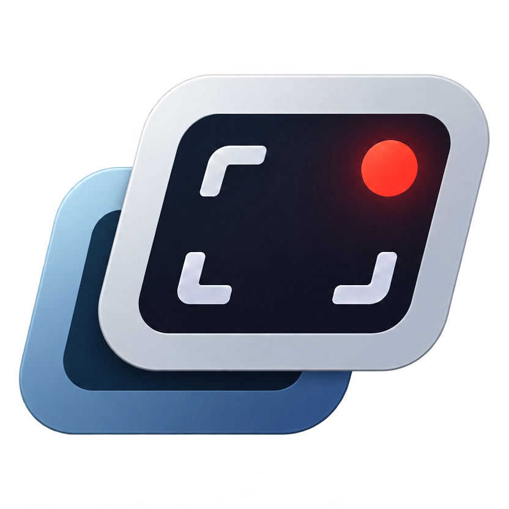

# Clipago

Сохраняй последние секунды экрана, обрезай клипы и собирай короткие видео.

[**Скачать Clipago для Windows x64**](https://github.com/greeeenie/clipago/releases/latest)

1. Нажми **Alt + F10** (по умолчанию), чтобы сохранить недавний момент. Для готового видео выбери **Добавить видео**.
2. Обрежь клип или собери несколько фрагментов во вкладке **Монтаж**.

Сочетание можно поменять в **Настройки → Дополнительно → Сохранить клип**.

Новые версии появляются в **Настройки → Обновления**.

[Лицензия MIT](LICENSE)
